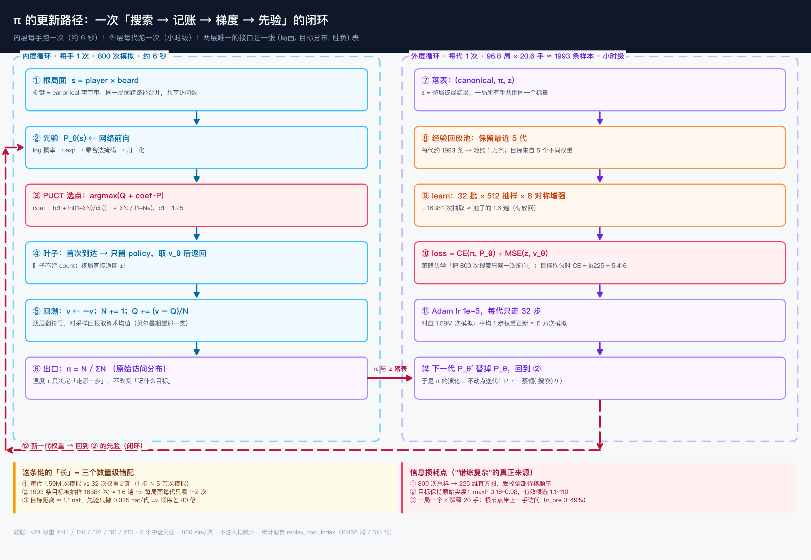

# π 的更新路径（实测）— v24

> 一句话：**π 的更新 = 对「搜索的访问分布」做监督回归**。目标不是"更正确的棋"，而是"这 800 次搜索在那个局面上得出的结论"。所以每代做的事本质是：把一次 800 sim 的结论，蒸馏成一次前向就能给出的先验。
>
> 本文所有数字都是实测（权重 it144/160/176/191/216，CPU，800 sim/次，不注入根噪声；训练统计取自 `gomoku_checkpoints_v24/replay_pool_index.json`）。



## 1. 链条本身

| 层 | 周期 | 每轮的量 |
|---|---|---|
| 树内 | ~6 s / 手 | 800 次 sim → 801 条边 → `π` |
| 每代 | 小时级 | **96.8 局 × 20.6 手 = 1993 条** 样本 → **1.59M 次 sim** |
| 训练 | 每代 1 次 | **32 步**梯度 × 512 抽样 × 8 增强 = 16384 抽取 |
| 跨代 | 数百代 | 先验漂移 **0.020~0.030 nat/代** |

代码落点（`Gomoku-v0_pt_v24.py`）：

- `search()` 出口：`count[s][loc] += 1`、`q[s][loc] += (v − q)/count`，`π = count/count.sum()`
- `decide()`：`prob = self.count[s]/self.count[s].sum()` → **温度只用于采样，`return_prob=True` 返回的是原始访问分布**
- `self_play()`：`trajectory.append((player, board, prob))`，最后一列 `winner` 是整局结果
- `learn()`：`CE(probs, pred_p) + MSE(pred_v, vs)`，`batches=32 × batch_size=512 × 8 对称增强`

## 2. 为什么"长"：三个数量级错配

1. **1.59M 次模拟 ↔ 32 次权重更新** → 平均 **1 步梯度 ≈ 5 万次模拟**的结论。
2. **1993 条目标 ↔ 16384 次抽取**（池 5 代 ≈ 1 万条）→ 池子只被过 **1.6 遍**；每个局面每代平均被看 1~2 次。
3. **目标距离 ≈ 1.1 nat，代际漂移 ≈ 0.025 nat/代** → 数量级差 40 倍。

⚠️ 第 3 条只是量级比较，**不能推出"要 44 代收敛"**：KL 不可加，而且目标每代随先验一起重算（移动靶）。

## 3. 目标离先验有多远（KL(π_search ‖ P_θ)，5 个中盘局面）

| ckpt | KL 均值 | H_target | H_prior | top1 命中 |
|---|---|---|---|---|
| it144 | 1.408 | 0.978 | 2.098 | 0.40 |
| it160 | 1.000 | 1.589 | 2.237 | 0.60 |
| it176 | 1.264 | 1.011 | 2.824 | **0.20** |
| it191 | 0.492 | 2.329 | 3.039 | 0.60 |
| it216 | 0.931 | 1.283 | 2.321 | 0.60 |

先验代间漂移（KL(P_cur ‖ P_prev) 均值）：`it144→160 0.362` / `it160→176 0.473` / `it176→191 0.377` / `it191→216 0.503`，跨 15~25 代 ⇒ **0.020~0.030 nat/代**。

**注意样本量**：只有 5 个局面，KL 没有系统性下降**不能**当作"没在学"。要判趋势至少要几十个局面 + 固定评估集。

## 4. 两个最容易忽略的点

### 4.1 根节点继承上一手的访问（n_pre）

树只在**每局开始** `reset_mcts()`，同局内复用。所以第 k 手的根 `count` 里带着第 k−1 手搜索留下的访问。实测一局 8 手：

```
第1手 0%   第2手 43.9%   第3手 34.1%   第4手 49.2%
第5手 1.2%  第6手 27.3%   第7手 4.3%    第8手 31.9%
（8 手均值 ≈ 24%）
```

⇒ **平均约 24% 的训练目标分母不是这一手搜出来的**，而是在父局面、不同噪声下搜的。目标因此是混合分布，不是干净的 800-sim 估计。

### 4.2 目标保持原始尖度，构成正反馈环

温度不影响记账，所以目标尖度完全由搜索的集中度决定。实测 `maxP` 跨 **0.083~0.982**、有效候选数 **1.1~110**（先验通常 4~28）。

例如 it176「看不见白棋活三」：目标 **98.1%** 压在一个点，先验还有 **18.6** 个有效候选。

> 目标越尖 → 先验越尖 → 下一轮探索越少 → 目标更尖。

这和中盘温度 0.15 时"30 手重复 12~17 次"是同一个环的两面（温度控走哪步，不控记什么）。

## 5. 附带结论：Q 更新属于「贝尔曼期望」而非「最优备份」

一并实测过（同一次 800 sim，坐标口径见「题目:长程杀」）：

| 检验 | 结果 | 判读 |
|---|---|---|
| `mean(returns)` vs `q` | 801 条边 max 差 **2.2e-16** | 就是算术均值，无隐藏项 |
| 终局 return 按深度 | depth 3/4/6 全 **1.000** | **γ=1** |
| `\|q − (−max q_child)\|` | 中位 **0.484**，≤0.05 仅 14/131 | 不是最优备份 |
| 根层 `q` vs `−E[q_child]` | N≥48 差 **0.0003~0.0016** | 满足**期望方程**（π ∝ N） |

即：`Q ← Q + (G − Q)/N`，`G` 是采样回报 ⇒ 策略评估；**策略改进在 PUCT 的访问分配里，不在 Q 里**（没有 max 算子）。

## 6. 复现方法（3 条）

1. 构造 `(N,15,15)`/`(N,4,15,15)` 的 canonical 输入，调 `agent.predict`，`exp(logp)` 后乘合法掩码归一化 ⇒ `P_θ`
2. `agent.reset_mcts()` 后连跑 800 次 `agent.search(canon, prior_noise=False, ...)` ⇒ `π_target = count/count.sum()`
3. `KL(π_target ‖ P_θ)`、`H(·)`、`exp(H)`（有效候选数）、`argmax` 是否同位

⚠️ 直接调 `search` = **无噪声口径**；`decide` 才注入 Dirichlet 噪声。两者数字不同，报告要说明是哪一种。

## 7. 想缩短这条链，只有三个杠杆

| 杠杆 | 作用 | 代价 |
|---|---|---|
| sim↑ | 靶更准 | 每代更慢 |
| 目标软标签（降低目标尖度） | 保留更多信息、破 4.2 的正反馈 | 探索 vs 精度的权衡，需实验 |
| 每代梯度步↑ | 搬得更快 | 冲掉旧知识（灾难性遗忘） |

三个都不该凭直觉拍——动之前先钉对照判据（固定局面集的 KL 曲线 + 对 Rapfi 的胜率），否则改完无法归因。
